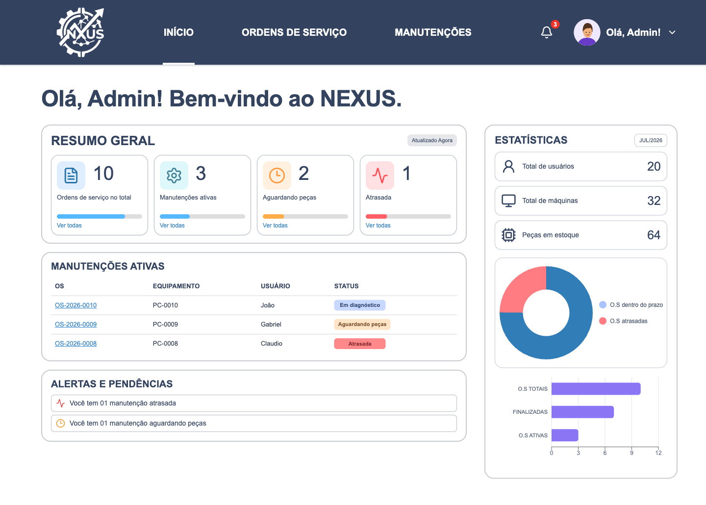

<p align="center">
  
</p>

<h1 align="center">NEXUS</h1>

<p align="center">
  Sistema de gestão de manutenção de equipamentos de TI
</p>

<p align="center">
  <a href="https://gabrielpedrosoftware.github.io/Nexus-Frontend/"><strong>Acessar demonstração</strong></a>
  ·
  <a href="#instalação-e-execução"><strong>Executar localmente</strong></a>
</p>

<p align="center">
  <a href="https://github.com/GabrielPedroSOFTWARE/Nexus-Frontend/actions/workflows/pages.yml">
    
  </a>
  
  
</p>

## Sobre o projeto

O NEXUS é uma aplicação web para acompanhar solicitações e manutenções de equipamentos de TI. Esta versão apresenta, em uma interface responsiva, os fluxos de quem solicita atendimento e da equipe administrativa.

Este repositório contém a interface do sistema. O GitHub Pages apresenta uma demonstração com dados simulados. Localmente, é possível conectar as funções disponíveis à API do backend.

## Captura de tela

<p align="center">
  
</p>

<p align="center"><sub>Os números e registros exibidos são dados de demonstração.</sub></p>

## Funcionalidades demonstradas

### Área do solicitante

- Consultar computadores vinculados ao usuário.
- Acompanhar o histórico de solicitações.
- Simular a abertura de uma solicitação de manutenção.
- Demonstrar a leitura das informações de um equipamento.

### Área administrativa

- Visualizar um resumo de ordens de serviço e manutenções.
- Acompanhar indicadores e gráficos de desempenho.
- Consultar ordens de serviço e detalhes de uma manutenção.
- Filtrar manutenções por situação.
- Demonstrar a atualização da situação de uma ordem de serviço.

## Tecnologias

- [React](https://react.dev/) para a construção da interface.
- [Vite](https://vite.dev/) para desenvolvimento e compilação do projeto.
- [React Router](https://reactrouter.com/) com `HashRouter` para navegação em hospedagem estática.
- [Recharts](https://recharts.org/) para os gráficos.
- [Lucide React](https://lucide.dev/) para os ícones.
- [Tailwind CSS](https://tailwindcss.com/) e CSS para os estilos.

## Instalação e execução

### Pré-requisitos

- Node.js que atenda a `^20.19.0 || >=22.12.0`, requisito da versão do Vite usada neste projeto.
- npm, incluído na instalação do Node.js.

### Preparar o projeto

```bash
git clone https://github.com/GabrielPedroSOFTWARE/Nexus-Frontend.git
cd Nexus-Frontend
npm ci
npm run dev
```

Depois, abra o endereço exibido no terminal. Por padrão, o Vite inicia em <http://localhost:5173>.

### Comandos disponíveis

| Comando | O que faz |
| --- | --- |
| `npm run dev` | Inicia o servidor de desenvolvimento. |
| `npm run build` | Gera a versão de produção na pasta `dist/`. |
| `npm run preview` | Abre localmente uma prévia da versão compilada. |

## Páginas da demonstração

As páginas podem ser acessadas pelas rotas abaixo. Como o projeto usa `HashRouter`, cada rota começa com `/#/`.

| Rota | Página |
| --- | --- |
| `/#/` | Entrada do sistema. |
| `/#/home` | Início do solicitante. |
| `/#/meus-pcs` | Equipamentos do solicitante. |
| `/#/historico` | Histórico de solicitações. |
| `/#/admin` | Início da área administrativa. |
| `/#/admin/ordens` | Ordens de serviço e indicadores. |
| `/#/admin/manutencoes` | Manutenções ativas. |
| `/#/admin/cadastro-usuario` | Cadastro demonstrativo de usuário. |

## Publicação no GitHub Pages

A publicação é feita pelo GitHub Actions, usando o fluxo de trabalho [`pages.yml`](.github/workflows/pages.yml). Ele compila o projeto e publica o conteúdo da pasta `dist/` quando há uma atualização no ramo `main`; também pode ser iniciado manualmente pela aba **Ações** do repositório.

Para configurar uma cópia do projeto, selecione **Configurações → Pages → GitHub Actions** como origem da publicação. O arquivo `vite.config.js` ajusta automaticamente o caminho-base para o endereço do repositório durante a execução do fluxo de trabalho.

**Demonstração publicada:** [gabrielpedrosoftware.github.io/Nexus-Frontend](https://gabrielpedrosoftware.github.io/Nexus-Frontend/)

## Estrutura do projeto

```text
.
├── .github/workflows/              # Publicação no GitHub Pages
├── docs/imagens/                   # Imagens usadas nesta documentação
├── public/                         # Imagens e identidade visual da aplicação
├── src/
│   ├── app/                        # Composição da aplicação e seleção de rotas
│   ├── assets/fonts/               # Fontes locais
│   ├── features/                   # Fluxos e dados de cada domínio
│   │   ├── access-requests/
│   │   ├── auth/
│   │   ├── equipment/
│   │   ├── service-orders/
│   │   ├── service-requests/
│   │   └── users/
│   ├── pages/                      # Telas separadas por perfil e rota
│   │   ├── admin/
│   │   ├── auth/
│   │   └── user/
│   ├── shared/                    # API genérica, layout e componentes comuns
│   ├── styles/                     # Estilos base, por área e ajustes responsivos
│   └── main.jsx                    # Inicialização do React
├── index.html                      # Documento HTML principal
├── package.json                    # Dependências e comandos
├── package-lock.json               # Versões das dependências
├── vite.config.js                  # Configuração do Vite e do caminho-base
└── README.md                       # Documentação do projeto
```

`app` conecta as telas e mantém a navegação. `pages` reúne as telas completas; `features` concentra componentes, dados e chamadas da API ligados a cada fluxo; `shared` contém partes reutilizadas. Em `styles/index.css`, os arquivos CSS são carregados na ordem necessária para preservar a apresentação.

A lógica de autenticação, equipamentos e solicitações fica em hooks dentro de `features/`. Arquivos chamados `demoData.js` guardam dados de exemplo usados nas telas demonstrativas.

## Escopo atual

A demonstração publicada no GitHub Pages não depende de backend. No modo local, login, equipamentos e pedidos usam a API configurada. As telas administrativas e os fluxos de cadastro de usuário e solicitação de acesso estão indisponíveis até a integração correspondente.

## Dúvidas e sugestões

Registre dúvidas, sugestões ou problemas na [área de problemas do repositório](https://github.com/GabrielPedroSOFTWARE/Nexus-Frontend/issues).


## Execução integrada local

Com o backend já iniciado na porta 8080 pelo responsável, configure o frontend:

```bash
cp .env.local.example .env.local
npm ci
npm run dev
```

No Windows, copie `.env.local.example` para `.env.local` pelo VS Code. Abra o endereço informado pelo Vite. O frontend encaminha as chamadas `/api` para `http://127.0.0.1:8080`; se necessário, ajuste `NEXUS_BACKEND_URL` no `.env.local` e reinicie o Vite. O arquivo `.env.local` não deve ser enviado ao Git.

O login, a leitura e o cadastro de equipamentos, os pedidos e o histórico dependem dos contratos da versão do backend em execução. As telas administrativas e a solicitação de acesso não estão integradas. As incompatibilidades entre versões e a segurança da API devem ser avaliadas pelo responsável pelo backend.

No GitHub Pages, sem API configurada, o sistema funciona apenas como demonstração: dados, login e ações são simulados e não são salvos. O proxy do Vite funciona apenas durante a execução local, não na hospedagem estática.
